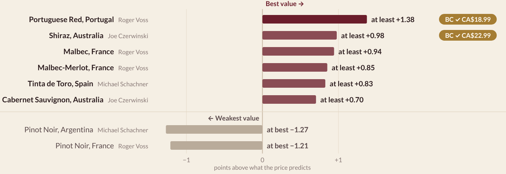
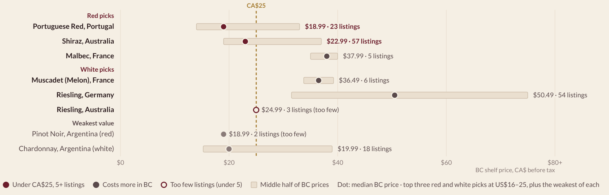

# Can You Taste the Price?

**Turning a familiar shopping question into a compelling data story.**

*Initiative · Creative problem framing · Consumer-focused analytics · Data storytelling · Team pitch*

Choosing wine often means interpreting price tags and critic scores with little context. Our UBC Sauder BAIT 518 team project started with a simple question: **which wine gives you more than you are paying for?** We developed that question into an interactive presentation connecting historical review data with a Vancouver shopper's **CA$25 before-tax budget**.

## My role: initiating the idea and presenting the story

I proposed the topic, title and initial project plan, prepared the first proposal deck, and presented my section of the team pitch. My contribution centered on initiating a relatable idea, shaping its first presentation and communicating the team's work.

This project is featured in my portfolio as an example of **initiative, creative framing and participation in a consumer-focused data story and pitch**. The final analysis, interactive presentation and supporting Tableau workbook were developed through the team contributions credited below.

## Start with the pitch

Download the repository and open [Can You Taste the Price.html](Can%20You%20Taste%20the%20Price.html) in a browser. Select **Present slides** for the pitch, or scroll through the story and explore the interactive shelf guide. It works offline; GitHub's HTML file view displays source code.

The story follows four steps:

1. **Make the decision relatable:** a shopper has a budget and limited time to choose.
2. **Challenge the obvious shortcut:** the share of wines scoring 90+ mostly follows price.
3. **Introduce a more useful comparison:** assess critic points relative to what the price predicts, accounting for uncertainty about critic effects.
4. **Bring the recommendation back to the shelf:** check whether the shortlisted groups fit the Vancouver budget.

[Read the storytelling approach](docs/STORYTELLING.md).

## The takeaway for the shopper

Portuguese red and Australian Shiraz combine positive historical score signals with lower BC category prices in the June 2026 snapshot.

| Historical group, US$16–25 tier | Reviews | Cautious points-above-price estimate | BC category listings | Median BC list price |
|---|---:|---:|---:|---:|
| Portuguese red | 535 | +1.38 | 23 | CA$18.99 |
| Australian Shiraz | 166 | +0.98 | 57 | CA$22.99 |

The cautious estimate is the lower of two models' 95% lower confidence limits. It is a historical group-level score signal, not a guarantee about an individual bottle or a shopper's taste. BC prices and listings are a dated snapshot, not current stock.

## Analytical foundation

The team used **111,538 reviews** with price and country information after deduplication and exclusions. The initial 90+ score metric correlates **0.69** with median price across 178 eligible groups; the final method instead benchmarks scores against price and compares models with and without critic adjustments.

A supporting sample of **451 matched wines** examines cross-market price patterns. The median BC/US list-price ratio is **1.56 CA$/US$**; currencies and time periods differ, so this is not a same-currency markup estimate.

This is **consumer-oriented decision support**, using critic reviews and prices. It does not directly measure consumer preferences, purchasing behavior or sales impact.

## Team credits and AI use

| Team member | Documented contribution |
|---|---|
| Arianna Falasca | Topic, title and initial plan; first proposal deck; team presentation |
| Willance Zheng | Metric development, analysis, interactive presentation, supporting Tableau workbook, animation, script and final report |
| Taha Saeed | Data cleaning and cleaning documentation |
| Max Chen | Part A video editing and presentation materials |
| Nanalin Sangthong | Part B video editing and team discussions |

ChatGPT supported my initial topic and plan; Muse supported my first deck. Claude supported Taha's cleaning and Willance's analysis, coding, design and writing; Codex supported analytical reviews. The Tableau workbook is credited to Willance and documented as built without AI. [Contribution and AI use](docs/AI-USE.md) provides details.

## Explore the supporting work

- **[Tableau workbook](tableau/Wine%20Value.twbx):** packaged with its cleaned Excel data; illustrates the relationship between price and the share scoring 90+. The full points-above-price analysis is in the Python pipeline and presentation.
- **[Method and limitations](docs/METHODS.md):** score benchmarks, critic sensitivity, matching and interpretation.
- **[Sources and data](data/README.md):** included BC and supporting tables, analytical outputs and raw-source setup.
- **[Reproduction instructions](docs/REPRODUCE.md)** and **[numerical checks](docs/VALIDATION.md)**.

Critic scores measure critic assessments, not consumer taste. Historical US review prices and June 2026 BC prices serve different purposes. Matching involves judgment; bottle-level checks reuse model-fitting reviews and are exploratory. This independent educational team project does not establish causal effects or measured commercial impact. Source data and third-party assets remain subject to their original terms.
